<!-- tailor:social-header:start -->
<p align="center">
  <a href="https://stream-sprout.wimpys.world"><picture><source media="(prefers-color-scheme: dark)" srcset="https://raw.githubusercontent.com/wimpysworld/stream-sprout/social-assets/hero-dark.svg"></picture></a>
</p>
<!-- tailor:social-header:end -->

<!-- tailor:social-links:start -->
<p align="center">
  <a href="https://bsky.app/profile/wimpys.world"><picture><source media="(prefers-color-scheme: dark)" srcset="https://raw.githubusercontent.com/wimpysworld/stream-sprout/social-assets/link-bluesky-dark.svg"></picture></a>
  <a href="https://wimpysworld.social/@martin"><picture><source media="(prefers-color-scheme: dark)" srcset="https://raw.githubusercontent.com/wimpysworld/stream-sprout/social-assets/link-mastodon-dark.svg"></picture></a>
  <a href="https://linkedin.com/in/martinwimpress"><picture><source media="(prefers-color-scheme: dark)" srcset="https://raw.githubusercontent.com/wimpysworld/stream-sprout/social-assets/link-linkedin-dark.svg"></picture></a>
</p>
<!-- tailor:social-links:end -->

<!-- tailor:social-community:start -->
<p align="center">
  <a href="https://discord.com/invite/vUsydfP"><picture><source media="(prefers-color-scheme: dark)" srcset="https://raw.githubusercontent.com/wimpysworld/stream-sprout/social-assets/community-dark.svg"></picture></a>
</p>
<!-- tailor:social-community:end -->

Stream Sprout receives a single RTMP stream from [OBS Studio](https://obsproject.com/) (or any RTMP encoder) through [FFmpeg](https://ffmpeg.org/) and forwards it to multiple destinations without transcoding. It runs beside OBS Studio on Linux or macOS without root privileges, third-party relay fees, or a separate web server.

## Features

- Restream one broadcast to Twitch, YouTube, [Owncast](https://owncast.online/), [PeerTube](https://joinpeertube.org/), and any `rtmp://` or `rtmps://` destination.
- Copy video and audio tracks without transcoding, so extra destinations add no extra encoding load.
- Keep active destinations live when one destination fails through FFmpeg's `onfail=ignore` tee option.
- Save an optional local Matroska (`.mkv`) archive of each broadcast with a timestamped filename.
- Manage all server and destination settings in one `stream-sprout.yaml` file that reloads between broadcasts.

<!-- tailor:social-stats:start -->
<p align="center">
  <a href="https://github.com/wimpysworld/stream-sprout/pulse"><picture><source media="(prefers-color-scheme: dark)" srcset="https://raw.githubusercontent.com/wimpysworld/stream-sprout/social-assets/stats-dark.svg"></picture></a>
</p>
<!-- tailor:social-stats:end -->

## Install

First-party signed package repositories are published for Linux and Nix through [wimpys.world](https://wimpys.world/). Choose your platform below for setup instructions and automatic updates.

<!-- tailor:social-packages:start -->
<p align="center">
  <a href="https://apt.wimpys.world/#stream-sprout"><picture><source media="(prefers-color-scheme: dark)" srcset="https://raw.githubusercontent.com/wimpysworld/stream-sprout/social-assets/pkg-apt-dark.svg"></picture></a>
  <a href="https://rpm.wimpys.world/#stream-sprout"><picture><source media="(prefers-color-scheme: dark)" srcset="https://raw.githubusercontent.com/wimpysworld/stream-sprout/social-assets/pkg-rpm-dark.svg"></picture></a>
  <a href="https://pkg.wimpys.world/#stream-sprout"><picture><source media="(prefers-color-scheme: dark)" srcset="https://raw.githubusercontent.com/wimpysworld/stream-sprout/social-assets/pkg-pkg-dark.svg"></picture></a>
  <br>
  <a href="https://apk.wimpys.world/#stream-sprout"><picture><source media="(prefers-color-scheme: dark)" srcset="https://raw.githubusercontent.com/wimpysworld/stream-sprout/social-assets/pkg-apk-dark.svg"></picture></a>
  <a href="https://nix.wimpys.world/#stream-sprout"><picture><source media="(prefers-color-scheme: dark)" srcset="https://raw.githubusercontent.com/wimpysworld/stream-sprout/social-assets/pkg-nix-dark.svg"></picture></a>
</p>
<!-- tailor:social-packages:end -->

<details>
<summary><strong>Container (GHCR)</strong> - run <code>ghcr.io/wimpysworld/stream-sprout:latest-alpine</code> on <code>linux/amd64</code> and <code>linux/arm64</code></summary>

Images are published to the GitHub Container Registry for `linux/amd64` and `linux/arm64`.

Pull the latest image:

```shell
docker pull ghcr.io/wimpysworld/stream-sprout:latest-alpine
```

Mount the directory that holds `stream-sprout.yaml` and expose the RTMP port:

```shell
docker run -p 1935:1935 -it -v "$PWD:/data" \
  ghcr.io/wimpysworld/stream-sprout:latest-alpine \
  --config /data/stream-sprout.yaml
```

- `-p 1935:1935` exposes the RTMP server port `1935` on the host. Change it when `stream-sprout.yaml` sets a different port.
- `-it` runs the container interactively.
- `-v "$PWD:/data"` mounts the current directory as `/data` inside the container.

Build the container image locally:

```shell
docker build -f Containerfile -t stream-sprout .
```

</details>

<details>
<summary><strong>From source</strong> - run directly with Bash 5.0 or later and FFmpeg</summary>

Stream Sprout requires Bash 5.0 or later and [FFmpeg](https://ffmpeg.org/) on `PATH`.

```shell
git clone https://github.com/wimpysworld/stream-sprout.git
cd stream-sprout
```

</details>

<!-- tailor:social-sponsors:start -->
<p align="center">
  <a href="https://github.com/sponsors/flexiondotorg"><picture><source media="(prefers-color-scheme: dark)" srcset="https://raw.githubusercontent.com/wimpysworld/stream-sprout/social-assets/sponsors-dark.svg"></picture></a>
</p>
<!-- tailor:social-sponsors:end -->

## Quick start

Create `stream-sprout.yaml` in your working directory (or copy [`stream-sprout.yaml.example`](stream-sprout.yaml.example)):

```yaml
server:
  ip: 127.0.0.1
  port: 1935
  app: sprout
  key: replace_with_uuidgen_key
  archive_stream: false
  archive_path: ~/Streams

services:
  twitch:
    enabled: true
    rtmp_server: rtmp://live.twitch.tv/app/
    key: your_twitch_stream_key
  youtube:
    enabled: true
    rtmp_server: rtmp://a.rtmp.youtube.com/live2/
    key: your_youtube_stream_key
```

Start Stream Sprout:

```shell
stream-sprout
```

In OBS Studio, open `Settings` > `Stream`, choose `Custom`, enter `rtmp://127.0.0.1:1935/sprout` as the `Server`, paste your `server.key` value into `Stream Key`, and click **Start Streaming**. Press <kbd>Ctrl</kbd>+<kbd>C</kbd> in the terminal to stop `stream-sprout`.

<!-- tailor:social-demo:start -->
<p align="center">
  
</p>
<!-- tailor:social-demo:end -->

| Option | Description |
| --- | --- |
| `--config <path>` | Load a configuration file from a custom path. |
| `--info` | Print operating system, container runtime, `awk`, `bash`, and `ffmpeg` versions for bug reports. |
| `--version` | Print the Stream Sprout and FFmpeg versions. |
| `--help` | Display usage help and exit. |

> [!WARNING]
> FFmpeg does not enforce the `app` or `key` path on its incoming RTMP listener and accepts any stream on the configured port. Do not expose the RTMP port to untrusted networks without a VPN, SSH tunnel, or firewall. Read [Security and limitations](https://github.com/wimpysworld/stream-sprout/wiki/Security-and-Limitations) before listening on a non-loopback address.

## Documentation

- [Configuration](https://github.com/wimpysworld/stream-sprout/wiki/Configuration) - Config search paths, `server:` options, local stream archiving, and Twitch, YouTube, Owncast, PeerTube, and RTMPS targets.
- [OBS Studio](https://github.com/wimpysworld/stream-sprout/wiki/OBS-Studio) - OBS Studio setup walkthrough and remote-host connection notes.
- [Security and limitations](https://github.com/wimpysworld/stream-sprout/wiki/Security-and-Limitations) - FFmpeg RTMP key enforcement caveat, VPN, SSH tunnel, and firewall hardening, and upload bandwidth limits.
- [References](https://github.com/wimpysworld/stream-sprout/wiki/References) - Upstream FFmpeg, OBS Studio, and container references plus `stream-sprout --info` bug-report guidance.

## Support and contributing

Read [Support](SUPPORT.md) for help and [Contributing](CONTRIBUTING.md) before submitting a change.

<!-- tailor:social-stars:start -->
<p align="center">
  <a href="https://github.com/wimpysworld/stream-sprout"><picture><source media="(prefers-color-scheme: dark)" srcset="https://raw.githubusercontent.com/wimpysworld/stream-sprout/social-assets/stars-dark.svg"></picture></a>
</p>
<!-- tailor:social-stars:end -->

<!-- tailor:social-contributors:start -->
<p align="center">
  <a href="https://github.com/wimpysworld/stream-sprout/graphs/contributors"><picture><source media="(prefers-color-scheme: dark)" srcset="https://raw.githubusercontent.com/wimpysworld/stream-sprout/social-assets/contributors-dark.svg"></picture></a>
</p>
<!-- tailor:social-contributors:end -->

<!-- tailor:social-footer:start -->
<p align="center">
  <a href="https://tailor.wimpys.world"><picture><source media="(prefers-color-scheme: dark)" srcset="https://raw.githubusercontent.com/wimpysworld/stream-sprout/social-assets/footer-dark.svg"></picture></a>
</p>
<!-- tailor:social-footer:end -->
