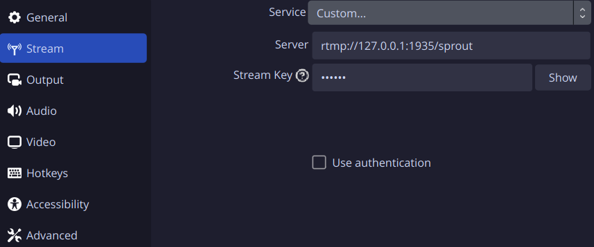

# OBS Studio

Connect [OBS Studio](https://obsproject.com/) to Stream Sprout as a custom RTMP service so one broadcast reaches every enabled destination in `stream-sprout.yaml`.

## Configure OBS Studio

1. Open OBS Studio.
2. Open `Settings` > `Stream`.
3. Select `Custom` from the `Service` dropdown.
4. Enter your Stream Sprout ingest URL in `Server`. With the default `server:` values in `stream-sprout.yaml`, enter:

   ```text
   rtmp://127.0.0.1:1935/sprout
   ```

5. Enter your `server.key` value from `stream-sprout.yaml` in `Stream Key` (leave it blank if `key` is unset).
6. Click `Apply` and `OK`.



## Start and stop a broadcast

1. Start `stream-sprout` in a terminal or container.
2. Click **Start Streaming** in OBS Studio. Stream Sprout logs the incoming audio and video details and begins forwarding to every enabled service.
3. Click **Stop Streaming** in OBS Studio when you finish. Stream Sprout finalises any local archive, reloads `stream-sprout.yaml`, and waits for the next stream.
4. Press <kbd>Ctrl</kbd>+<kbd>C</kbd> in the terminal to stop `stream-sprout`.

## Encoder settings for multiple platforms

Stream Sprout copies the video and audio streams (`-c:v copy -c:a copy`) without transcoding. Every enabled platform receives the exact bitrate, resolution, frame rate, and keyframe interval that OBS Studio produces.

Choose OBS Studio output settings that all enabled destinations accept. A 2-second keyframe interval, H.264 video, AAC audio, and a bitrate within the lowest platform limit (for example 6,000 kbps for Twitch) work reliably across Twitch, YouTube, Owncast, and PeerTube.

## Connecting to a remote host

Stream Sprout works best on the same machine as OBS Studio, bound to `127.0.0.1`. When you run Stream Sprout on a separate machine, match the OBS Studio `Server` field to how you reach that host:

- **Over a private VPN (recommended):** Set `server.ip` in `stream-sprout.yaml` to the host's VPN IP address and set OBS Studio `Server` to `rtmp://<vpn-ip>:1935/sprout`.
- **Over an SSH tunnel:** Keep `server.ip: 127.0.0.1` on the remote host, forward port `1935` to your local machine, and leave OBS Studio pointed at `rtmp://127.0.0.1:1935/sprout`.
- **Over a trusted LAN:** Set `server.ip` to the host's LAN IP address (or `0.0.0.0` to listen on all interfaces) and set OBS Studio `Server` to `rtmp://<lan-ip>:1935/sprout`.

> [!WARNING]
> Do not expose the Stream Sprout RTMP port to the public internet. FFmpeg accepts any incoming stream on the listening port even when `server.key` is set. Follow the hardening steps in [Security and limitations](Security-and-Limitations).
